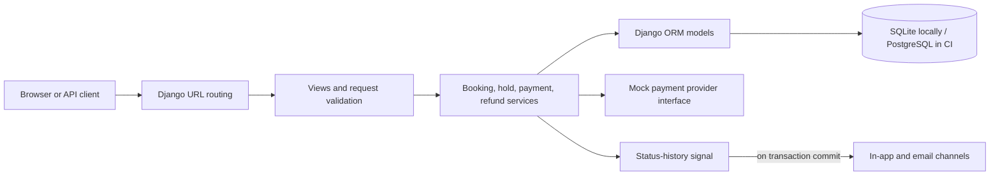

# TicketFlow Architecture

TicketFlow is a Django application with server-rendered templates and a small
DRF API for seat holds, bookings, payments, refunds, and notifications. Business
operations are kept primarily in service modules; views validate requests,
enforce access boundaries, call services, and serialize responses.

## Project structure

```text
accounts/
  models.py, forms.py, permissions.py, views.py, urls.py
events/
  models.py
  views.py, booking_views.py, notification_views.py, urls.py
  services.py                 # Seat holds
  booking_services.py         # Booking creation, expiry, transitions
  payment_services.py         # Payment initiation and idempotency
  payment_providers.py        # Common protocol and mock providers
  refund_services.py          # Cancellation/refund orchestration
  pricing.py                  # Pricing validation and calculation
  notification_channels.py    # In-app and email channels
  signals.py                  # Seat inventory and post-commit notification hooks
health/
  views.py, urls.py
config/
  settings.py, urls.py, asgi.py, wsgi.py
templates/
  accounts/, events/
```

- `accounts` defines the custom user, registration/login, and role checks.
- `events` contains event and ticketing models, web/API views, services,
  provider/channel abstractions, and feature-focused test modules.
- `health` exposes the application health endpoint.
- `config` configures Django, environment-based settings, and root URLs.
- `templates` contains the server-rendered user interface.

## Request and service flow



Server-rendered event and account pages use Django templates. DRF endpoints
accept JSON for hold and booking operations and return booking/payment data.

## Main data model

- `accounts.User` extends Django's `AbstractUser` with a `CUSTOMER` or
  `ORGANIZER` role.
- `Event` belongs to an organizer and stores event details, seat-map dimensions,
  pricing strategy, and early-bird eligibility timestamps.
- `EventCategory` belongs to one event and stores a category name, base price,
  and optional early-bird price. Category names are unique within an event.
- `Seat` belongs to an event and has row/seat coordinates and an optional
  category. The application validates that its category belongs to the same
  event.
- `SeatHold` belongs to a seat and customer, with status and expiry timestamps.
- `Booking` belongs to a customer and event. Its `BookingSeat` rows reference
  seats and store immutable price and category-name snapshots. A category FK
  is also retained for historical reference.
- `BookingStatusHistory` records each status change, time, actor, and reason.
- `Payment` belongs to a booking and stores provider, amount, status,
  idempotency key, references, and processing timestamps.
- `Refund` is linked one-to-one with a payment and records refund amount,
  provider reference, status, timestamps, and failure reason.
- `Notification` belongs to a recipient and booking, and stores type, message,
  read state, and creation time.

Bookings protect their event and customer history from deletion. Booking-seat
`BookingSeat.booking`, `.seat`, `.category`, and `.source_hold` all use
`on_delete=PROTECT`; `category` is nullable, and `source_hold` is a one-to-one
relation. Booking rows therefore preserve their referenced booking, seat,
category (when set), and hold records. The category migration creates
a `General` category per existing event, assigns seats and historical booking
rows to it, and leaves historical `unit_price` values unchanged.

## Authentication, roles, and ownership

Django authentication provides sessions and the custom user model. Public
registration creates customers; organizer-only views use `role_required`.
Event and category management query objects through the current organizer's
owned events. Booking, payment, cancellation, and notification API queries are
scoped to the authenticated customer. Hold and booking services also check the
customer role and ownership, rather than relying solely on view-level checks.

## Holds, booking lifecycle, and expiry

Seat holds are created for authenticated customers and expire after five
minutes. A booking is created atomically from a complete set of active,
unexpired holds owned by the caller and associated with the requested event.
Every seat receives a price/category snapshot at booking creation.

```mermaid
stateDiagram-v2
    [*] --> HELD: Create booking from active holds
    HELD --> PENDING_PAYMENT: Start payment
    HELD --> EXPIRED: Reservation expires
    HELD --> CANCELLED: Customer cancellation
    PENDING_PAYMENT --> CONFIRMED: Mock provider approves
    PENDING_PAYMENT --> EXPIRED: Reservation expires
    PENDING_PAYMENT --> CANCELLED: Customer cancellation
    CONFIRMED --> CANCELLED: Customer cancellation
    PENDING_PAYMENT --> PENDING_PAYMENT: Mock payment declines; retry allowed
```



`booking_services.py` owns allowed transitions and writes history for them.
Expired holds are marked expired when later seat/booking operations encounter
them; due bookings are expired during relevant seat, booking-list/detail, or
payment operations. There is no scheduled background expiry worker, so expiry
cleanup is lazy rather than guaranteed to run at the exact expiration instant.

## Transactions, concurrency, and constraints

Hold creation and conversion to a booking use `transaction.atomic()`. Seat
operations lock seats in primary-key order with `select_for_update()`, then
validate/update holds and booking allocation. Booking creation persists booking,
booking seats, hold conversion, and initial status history in one transaction.
Payment and cancellation services likewise use transactions and acquire seat,
booking, and related record locks in a consistent order.

Database constraints backstop application checks, including unique seat
coordinates and one active hold per seat. For `BookingSeat`, `(booking, seat)`
must be unique for every row, while `seat` must be unique only among rows where
`occupies_seat=True`; historical non-occupying rows may therefore refer to a
seat already present in another such row. `source_hold` is also unique because
it is a one-to-one relation. Other constraints cover valid status/price ranges,
unique payment idempotency keys per booking, and one refund per payment. The
hold-conversion query locks only the `SeatHold` rows
(`select_for_update(of=("self",))`) while selecting its nullable category
relationship; seats have already been locked earlier in the transaction.

SQLite is the default local backend and does not provide PostgreSQL's row-level
`SELECT FOR UPDATE` locking behavior. The hold and booking concurrency tests
are explicitly skipped unless the database vendor is PostgreSQL. GitHub Actions
starts PostgreSQL and configures `DB_ENGINE=postgresql`, so those tests are
intended to execute in CI. A successful SQLite test run alone does not establish
the PostgreSQL concurrency guarantee.

## Pricing

The organizer chooses the event's `BASE` or `EARLY_BIRD` strategy. Category
base and early-bird prices are stored as decimals. During the configured
eligibility window, early-bird pricing applies from its start inclusive to its
end exclusive; otherwise the category base price applies. Booking creation
calculates each selected seat's price on the server and snapshots the category
name and unit price. Booking totals are aggregated from these snapshots, not
from current category prices or client input.

## Payment providers and idempotency

`PaymentProvider` in `payment_providers.py` defines payment and refund
operations. `MockSuccessProvider` and `MockFailureProvider` simulate outcomes
without credentials, external API calls, or money movement. `PAYMENT_PROVIDER`
selects the provider. Payment amounts come from booking-seat snapshots, and a
unique `(booking, idempotency_key)` constraint and payment service prevent a
retry from creating a second payment for the same key. Processing payments use
a short lease before a retry may resume.

These are mock-only guarantees. The current providers do not charge or refund
money, and production configuration rejects the mock providers; this repository
does not implement a real gateway.

## Notifications

`NotificationChannel` defines the channel interface. The in-app channel
persists a notification; the email channel uses Django's email framework, with
the console backend as the default. A `BookingStatusHistory` post-save signal
registers confirmation/cancellation dispatch with `transaction.on_commit`, so
dispatch runs only after the transaction commits. A unique constraint on
`(booking, notification_type)` prevents duplicate in-app notifications for the
same transition type. Email is synchronous and is attempted only when the
in-app row is newly created; delivery is not exactly-once and is not retried.
Email errors are logged without undoing a successful booking change.

## Cancellation and refunds

Customers may cancel only their own bookings through the cancellation service.
Only a previously confirmed booking is refund-eligible. There is no dedicated
refund endpoint: cancellation and any eligible refund are handled together by
`POST /events/bookings/<booking_id>/cancel/`. The event start time is combined
with Django's current project timezone; cancellation more than 24 hours before
that time receives a full refund of successful mock payments. Exactly 24 hours
or less receives no refund. Refund execution is synchronous through the
payment provider abstraction, and a one-to-one payment/refund relationship
prevents duplicate refund records. Since current providers are mocks, an
approved refund is a simulation rather than money returned.

## Settings and tests

`config/settings.py` reads secrets, environment, database, payment-provider,
and email settings from environment variables (with `.env` loading for local
development). SQLite is the local default; PostgreSQL is configurable.

Tests use pytest and pytest-django. Separate modules cover account roles, event
and hold behavior, booking lifecycle, pricing/category behavior, payments,
refunds, notifications, and migration behavior. Django system and migration
consistency checks are also run in CI.
