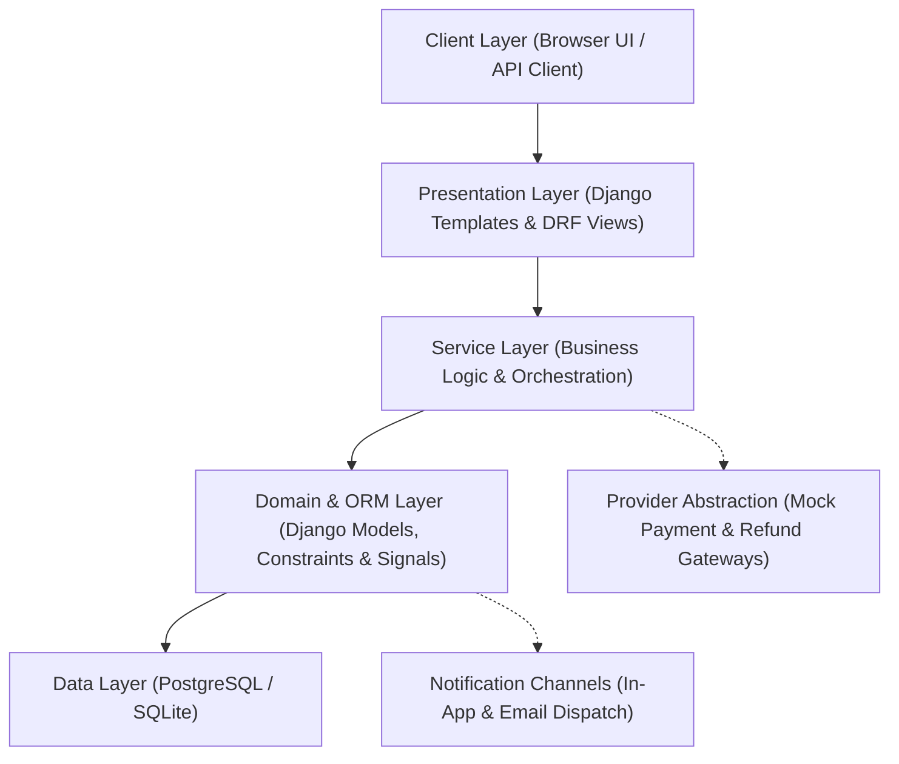

# TicketFlow Architecture

TicketFlow is an enterprise-grade event ticket booking platform built with Django, Django REST Framework, Bootstrap 5, and PostgreSQL. It delivers transactional reliability, atomic seat allocations, concurrent race-condition prevention, and clean separation of concerns.

---

## Architectural Layers

TicketFlow is designed using a multi-tier layered architecture:



1. **Client Layer**:
   Responsive Bootstrap 5 frontend rendered by Django templates, supplemented by lightweight vanilla JavaScript for dynamic SVG seat map interactions, 5-minute countdowns, and CSRF-protected hold submissions.
2. **Presentation / View Layer** (`events/views.py`, `events/booking_views.py`, `events/notification_views.py`):
   Handles HTTP request validation, authentication checks, role-based authorization (`Customer` vs `Organizer`), dual-mode template rendering and DRF JSON serialization. Views delegate all core business decisions to the Service Layer.
3. **Service Layer** (`events/services.py`, `events/booking_services.py`, `events/payment_services.py`, `events/refund_services.py`, `events/pricing.py`):
   Encapsulates all domain workflows, transactional boundaries (`transaction.atomic()`), concurrency locks (`select_for_update`), state transitions, and business rules (e.g., 24-hour refund cutoff, 5-minute hold expiry).
4. **Domain & ORM Layer** (`events/models.py`, `accounts/models.py`, `events/signals.py`):
   Defines relational entities, database-level constraints (uniqueness, foreign key cascades/protections, check constraints), and transaction lifecycle hooks (`transaction.on_commit`).
5. **Data Layer**:
   PostgreSQL in production and CI, providing true row-level locking (`SELECT FOR UPDATE`), ACID guarantees, and concurrency safety. SQLite is supported for fast local development.

---

## Actual Design Patterns & Why Each Is Used

### 1. Service Layer Pattern
- **Modules**: `services.py`, `booking_services.py`, `payment_services.py`, `refund_services.py`
- **What it is**: Business logic is separated from Django view functions and fat models into cohesive service modules.
- **Why it is used**: Keeping complex operations (such as acquiring ordered seat locks, calculating early-bird pricing, verifying hold ownership, converting holds to bookings, and recording status history) outside views prevents controller bloat, avoids code duplication between HTML and REST endpoints, and makes core business logic independently unit-testable.

### 2. Strategy / Provider Pattern
- **Modules**: `events/payment_providers.py`
- **What it is**: Defines an abstract `PaymentProvider` interface with interchangeable implementations (`MockSuccessProvider`, `MockFailureProvider`).
- **Why it is used**: Decouples payment processing and refund execution from third-party vendor APIs. The application can switch providers via environment variables (`PAYMENT_PROVIDER=mock_success` or `mock_failure`) without altering a single line of booking or payment orchestration code. In production, mock providers fail closed unless explicitly enabled for demo evaluations.

### 3. State Machine Pattern
- **Modules**: `events/models.py` (`Booking.Status`), `events/booking_services.py`
- **What it is**: Formally defines the lifecycle of a booking and restricts transitions through a controlled state machine:
  ```mermaid
  stateDiagram-v2
      [*] --> HELD: Create booking from active holds
      HELD --> PENDING_PAYMENT: Start payment
      HELD --> EXPIRED: 5-minute hold expires
      HELD --> CANCELLED: Customer cancellation
      PENDING_PAYMENT --> CONFIRMED: Payment succeeds
      PENDING_PAYMENT --> EXPIRED: Reservation expires
      PENDING_PAYMENT --> CANCELLED: Customer cancellation
      CONFIRMED --> CANCELLED: Customer cancellation (>24h full refund, <=24h no refund)
      PENDING_PAYMENT --> PENDING_PAYMENT: Payment declines; retry allowed with new key
  ```
- **Why it is used**: Prevents invalid business states (e.g. paying for an expired booking, confirming a cancelled reservation, or double-refunding). Every transition is audited in `BookingStatusHistory` with timestamp, actor, and reason.

### 4. Snapshot Pattern
- **Modules**: `events/models.py` (`BookingSeat`)
- **What it is**: At the moment a booking is created, the system copies the calculated price and category name into immutable fields (`unit_price`, `category_name`, `category_id`) on each `BookingSeat` row.
- **Why it is used**: Event organizers frequently change category base prices or early-bird deadlines. Without snapshots, recalculating an existing booking's total would alter historical financial records. The Snapshot pattern guarantees that confirmed bookings and customer receipts remain permanently immutable.

### 5. Observer / Signal Pattern with Post-Commit Dispatch
- **Modules**: `events/signals.py`, `events/notification_channels.py`
- **What it is**: A `post_save` receiver on `BookingStatusHistory` registers notification dispatches using `transaction.on_commit(...)`.
- **Why it is used**: In-app notifications and emails must only be sent when a transaction has successfully committed to the database. If a database transaction rolls back due to a downstream error, `transaction.on_commit` ensures no false-positive confirmation or cancellation messages are ever emitted to users.

### 6. Idempotency Key Pattern
- **Modules**: `events/payment_services.py`, `events/models.py` (`Payment`)
- **What it is**: Payment initiation requires a client-supplied `Idempotency-Key` header, enforced by a unique database constraint on `(booking, idempotency_key)`.
- **Why it is used**: Prevents double-charging caused by accidental double-clicks, browser refreshes, or network timeouts. Re-submitting the same key safely returns the existing payment record without creating duplicate transactions.

---

## Concurrency & Transaction Management

TicketFlow prevents race conditions (e.g., two users attempting to hold or book the same seat simultaneously) through robust concurrency controls:

1. **Row-Level Locking (`SELECT FOR UPDATE`)**:
   When holding seats or converting holds into bookings, seats are queried with `select_for_update()` ordered by `id` (to prevent deadlocks).
2. **Selective Lock Targeting (`of=("self",)`):**
   When joining nullable foreign keys (e.g. `SeatHold.category`), locks are explicitly constrained to `SeatHold` rows (`select_for_update(of=("self",))`), resolving PostgreSQL outer-join locking errors.
3. **Database Constraints as Safety Nets**:
   - `events_one_active_booking_per_seat`: Partial unique constraint ensuring only one `BookingSeat` with `occupies_seat=True` can exist for any physical seat.
   - Unique constraints on active `SeatHold` records.
   - Unique constraints on `(booking, idempotency_key)` and `(payment, refund)`.

---

## Pricing System & Seat Categories

1. **`BASE` Strategy**: Standard fixed pricing for an event. Seats without a specific category inherit the event's base price; categorized seats use their category base price.
2. **`EARLY_BIRD` Strategy**: Time-window pricing. Configured with an eligibility window (`early_bird_starts_at` to `early_bird_ends_at`). During the window, seats receive discounted rates; outside the window, prices automatically revert to standard base prices.
3. **Multi-Category Seat Mapping (`EventCategory`)**: Organizers define seating tiers (e.g., VIP, Premium, General) and map seat rows to specific categories. Tiering is handled via model relationships rather than an enum strategy.

---

## Settings & Environment Structure

- `config/settings.py` reads configuration strictly from environment variables via `python-dotenv`.
- Secret keys and database credentials are never committed.
- In production (`DJANGO_ENV=production`):
  - WhiteNoise serves compressed and manifest-cached static assets.
  - Security headers (`SECURE_SSL_REDIRECT`, `SESSION_COOKIE_SECURE`, `CSRF_COOKIE_SECURE`, `SECURE_PROXY_SSL_HEADER`) are enforced.
  - Mock payments fail closed unless `ALLOW_MOCK_PAYMENTS_IN_PRODUCTION=True` is explicitly opted-in for demo evaluations.
